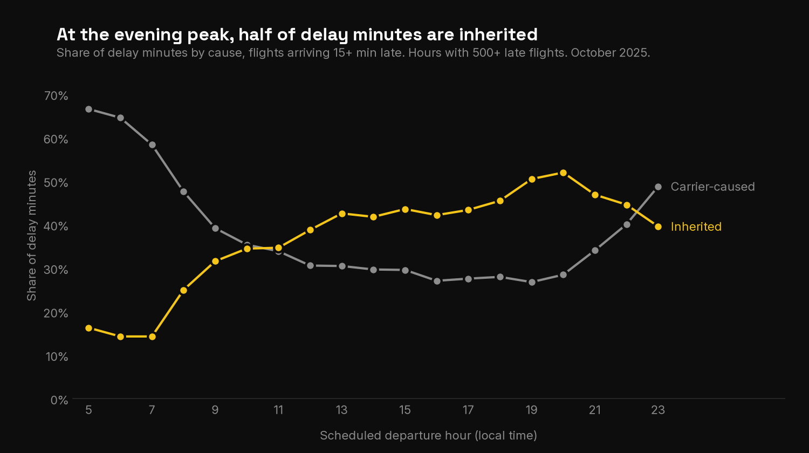
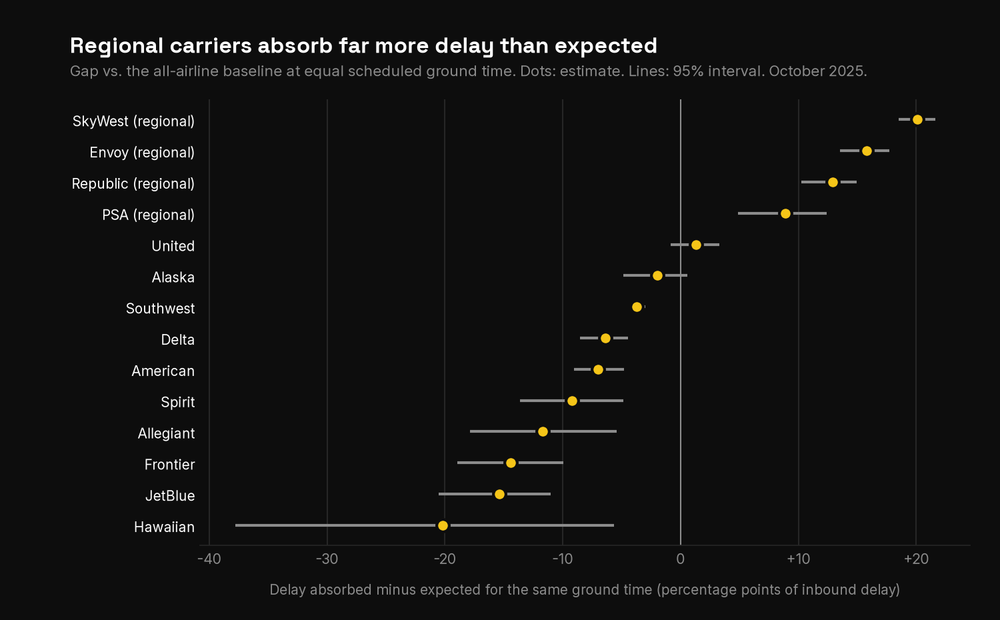
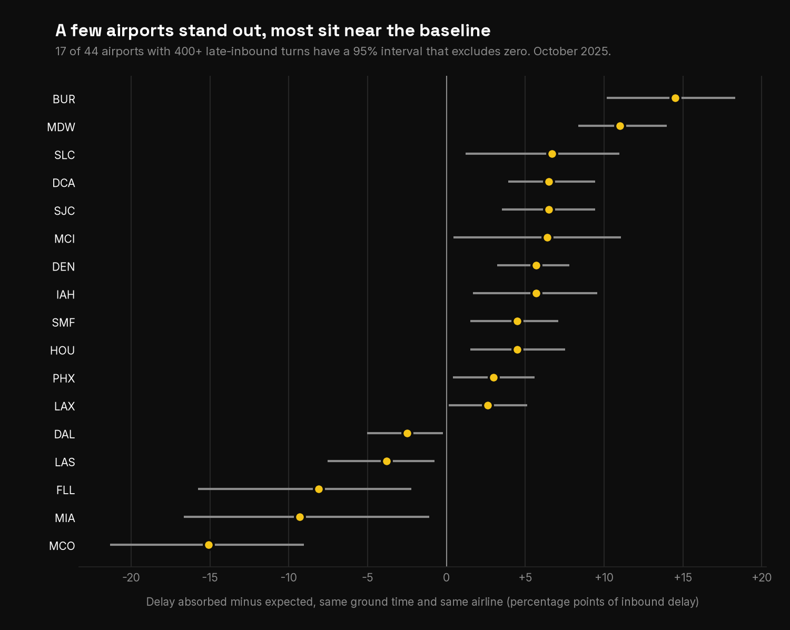
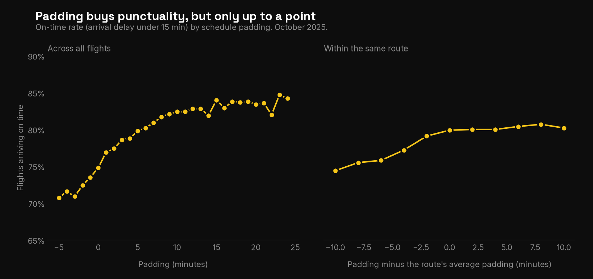
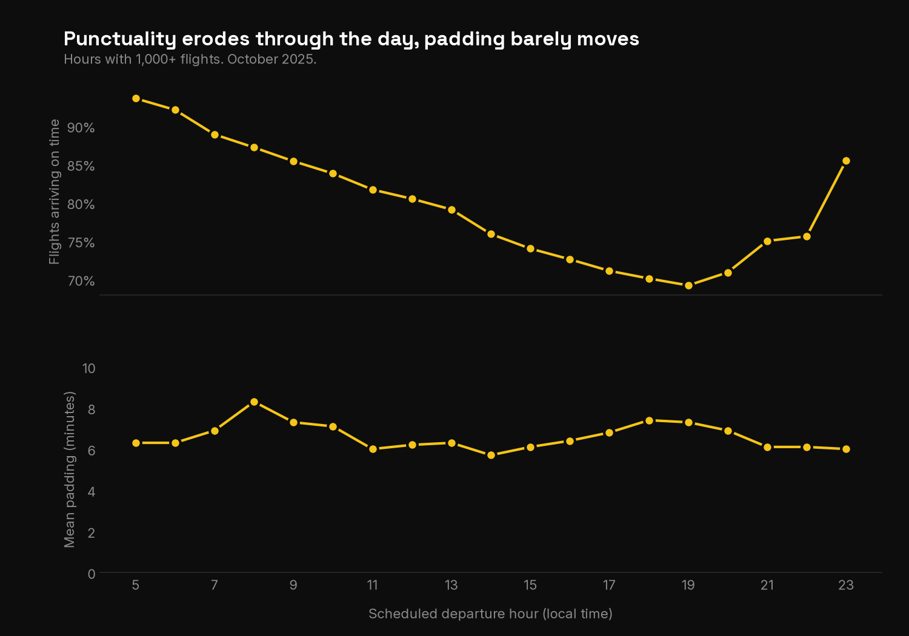

# Where and why is punctuality lost?

An analysis of US airline punctuality using the BTS Reporting Carrier On-Time Performance data (October 2025: 605,844 flights, 14 airlines, 5,681 aircraft, 346 airports). The work follows two axes, **delay propagation through aircraft rotations** and **schedule padding**, and ties them together at the end.

Built with Python, Parquet and DuckDB.

## Key findings

**1. Punctuality is lost through the day, and a large part of it is inherited.**
On-time arrival falls from 93.6% for 5:00 departures to 69.2% for 19:00 departures. The share of delay minutes inherited from the previous flight of the same aircraft rises from 14% in the first wave to 50–52% at 19:00–20:00.

**2. Aircraft absorb delay by shortening their ground time, and airlines differ a lot.**
Compared at the same scheduled ground time, the four regional carriers absorb between +9 and +20 percentage points more of their inbound delay than the all-airline baseline (SkyWest +20.1, Envoy +15.8, Republic +12.9, PSA +8.9). JetBlue, Frontier, Allegiant and Spirit sit 9 to 15 points below it. Hawaiian has the lowest estimate but a very wide interval.

**3. Airport effects are smaller than airline effects.**
After accounting for ground time and airline, most airports sit near the baseline and large hubs (ATL, ORD, DFW, JFK, CLT) are indistinguishable from it. The clear outliers are BUR (+14.5) and MDW (+11.0) on the positive side and MCO (−15.1), MIA (−9.3) and FLL (−8.1) on the negative side.

**4. Schedule padding helps up to the route's norm and little beyond it.**
Median padding is 6 minutes (middle half of flights between 3 and 10). Within the same route, flights scheduled 10 minutes tighter than the route's average arrive on time 74.4% of the time versus 79.9% at the average, while extra padding beyond the average adds almost nothing (80.7% at +8 minutes).

**5. Padding does not follow the daily deterioration.**
Mean padding stays between 5.7 and 8.3 minutes through the day while on-time rate drops almost 25 points. Across airlines, padding does not order punctuality either: Frontier pads the most (median 11 minutes) and arrives on time 77.6% of the time, while Delta (median 6) is the most punctual at 84.0%.

**Takeaway.** Delay accumulates along rotations as the day goes on, and schedules do not add margin where propagation is greatest. Ground-time absorption is the main buffer, and it varies far more across airlines than across airports.

## Method in brief

- **Data:** BTS Reporting Carrier On-Time Performance, 28 selected fields, downloaded manually and converted to Parquet (ZSTD) with DuckDB.
- **Rotations:** flights are chained by tail number ordered by scheduled departure. Times are local, so the time-zone offset of each flight is recovered from the data (arrival − departure − scheduled elapsed time). A pair of consecutive flights counts as a turnaround when the previous destination equals the next origin.
- **Absorption:** absorbed minutes = inbound delay − outbound delay = scheduled ground time − actual ground time. Only turnarounds with at least 15 minutes of inbound delay and scheduled ground time between 30 minutes and 4 hours are used.
- **Airline and airport gaps:** expected absorption comes from the all-airline curve by 15-minute ground-time band; the gap is actual minus expected, as a share of inherited delay. Airport gaps also remove each airline's own gap. Intervals are 95% bootstrap intervals resampling aircraft.
- **Padding:** scheduled block time minus the median actual block time of the same directional route (30+ flights), definitions fixed before looking at results.
- **Delay causes:** BTS cause breakdown, available only for flights arriving 15+ minutes late.

## Limitations

- One month of data (October 2025), US domestic flights only.
- No control for aircraft type, route length or weather; results are associations, not causal effects.
- Regional carriers fly for partner brands, so their gap may reflect operating model or schedule design rather than airline skill.
- The baseline is the pooled average, not an optimum, so the sign of large carriers' gaps is partly mechanical.
- Bootstrap intervals capture dependence between flights of one aircraft but not shared daily shocks such as weather or air-traffic programs.
- With 44 airports tested, one or two significant airport results can be chance.
- Delay causes are reported by airlines following BTS conventions.

## Repository structure
bts-delay-propagation/
├── data/ # not versioned: raw ZIPs and Parquet files
├── figures/ # charts used in this README
├── notebooks/
│ ├── 01_data_quality.ipynb
│ ├── 02_rotations.ipynb
│ ├── 03_schedule_padding.ipynb
│ └── 04_link_axes.ipynb
├── src/
│ └── 01_csv_to_parquet.py
├── requirements.txt
└── README.md

## Reproduce

1. Download the BTS "Reporting Carrier On-Time Performance (1987–present)" data for the month you want, with the same 28 fields, and place the ZIP files in `data/raw/`.
2. Create a virtual environment and install dependencies: `pip install -r requirements.txt`.
3. Convert to Parquet: `python src/01_csv_to_parquet.py`.
4. Run the notebooks in order.

## Fonts

Charts use Space Grotesk (titles) and Inter (body). They fall back to DejaVu Sans if not installed.